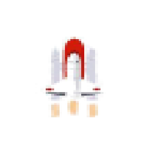
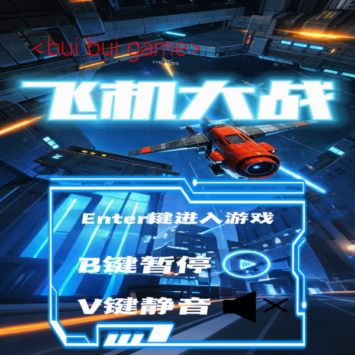
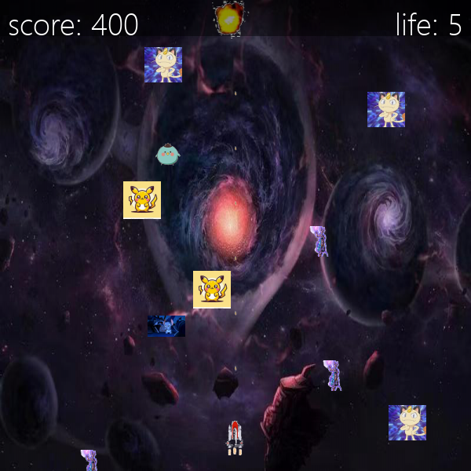
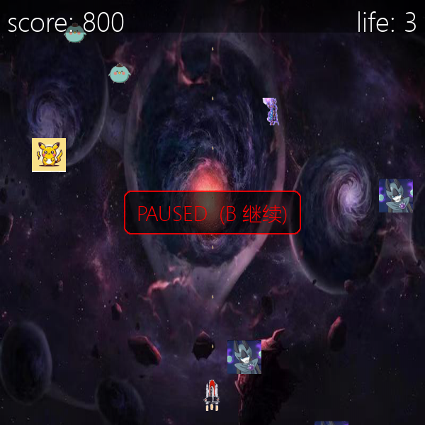

<p align="center">
  
</p>

<h1 align="center">飞机大战 · Airplane Battle</h1>

<p align="center">
  <b>方向键躲、空格打、别让敌机撞上来。</b><br>
  一个用 Pygame 写的复古太空射击：单文件、零配置、双击就跑。
</p>

<p align="center">
  作者：<a href="https://github.com/black-mouse-sha"><b>LittlePerson</b></a>
</p>

<p align="center">
  <a href="requirements.txt"></a>
  <a href="requirements.txt"></a>
  <a href="LICENSE"></a>
  <a href=".github/workflows/smoke.yml"></a>
</p>

<p align="center">
  <a href="docs/USAGE.md">完整使用手册</a> ·
  <a href="#30-秒上手">30 秒上手</a> ·
  <a href="docs/ARCHITECTURE.md">架构与实现</a> ·
  <a href="docs/diagrams/">交互式架构图</a> ·
  <a href="#常见问题">常见问题</a>
</p>

---

> [!NOTE]
> 想要能直接点开的版本：[GitHub Pages 落地页](https://black-mouse-sha.github.io/Airplane-Battle/)
> （用 Pages 打开仓库根目录的 `index.html`，纯静态，不需要构建）。

## 长什么样

| 引导页 | 对局中 |
|:---:|:---:|
|  |  |
| 贴着 Enter 进游戏，B 暂停 / V 静音 | 左上分数、右上生命；命中 +100，撞机 -1 血 |

<details>
<summary>展开看：暂停画面</summary>

| 暂停 |
|:---:|
|  |
| 暂停时只重绘不更新；中央提示带底色，压得住背景 |

</details>

> 截图由 `docs/images` 里的实际渲染结果生成，不是示意图。

## 30 秒上手

### Windows：双击 `run.bat`

首次运行会自动建 `.venv`、装 `pygame`，然后直接开游戏。

### macOS / Linux

```bash
chmod +x run.sh && ./run.sh
```

### 手动（任何系统）

```bash
python -m venv .venv
# Windows
.venv\Scripts\activate
# macOS / Linux
source .venv/bin/activate

pip install -r requirements.txt
python game.py
```

装了依赖但想直接跑：`python game.py`。

> 需要 Python 3.9+。`pygame` 有官方 wheel，不用编译；装得慢就加
> `-i https://pypi.tuna.tsinghua.edu.cn/simple` 换源。

## 操作

| 按键 | 作用 |
|---|---|
| `←` `→` `↑` `↓` | 移动飞船 |
| `空格` | 发射子弹（100ms 冷却） |
| `Enter` | 从引导页开始 |
| `B` | 暂停 / 继续 |
| `V` | 静音 / 取消静音 |
| `ESC` | 直接退出 |

## 规则

| 项 | 数值 |
|---|---|
| 初始生命 | 5 |
| 击毁敌机 | +100 分 |
| 被撞击 | -1 生命，随后 800ms 无敌 |
| 敌机 | 每 300ms 生成一架，最多同时 15 架，下落 3 像素/帧 |
| 子弹 / 飞船速度 | 10 像素/帧 |
| 死亡 | 停留 3 秒后退出 |

## 它做对了什么

- **素材路径跟脚本走**：`resource_path()` 用 `__file__` 定位 `game/`，双击、快捷方式、任意工作目录都能跑。
- **缺素材不会甩你一屏 traceback**：直接告诉你缺哪个文件、该怎么办。
- **没有声卡也能玩**：`mixer.init()` 失败自动降级静音，只是没有音效。
- **掉帧不影响节奏**：射击冷却、敌机生成、爆炸动画全按绝对毫秒算，不靠帧计数累加。
- **爆炸是真的在动**：`boom.png` 是 63x241 的竖排 4 帧序列图，按 250ms 一帧播完 1 秒；原版把整张图一次性贴上去，会出现一条白色长条。
- **抠图是离线的**：素材的"透明背景"其实是画上去的棋盘格，`tools/clean_assets.py` 用漫水填充一次性处理干净，运行期没有额外开销。
- **能被 CI 验证**：`--smoke-test 600` 在无显示器、无声卡的机器上跑满 600 帧，退出码就是结论。

## 功能一览

| 能力 | 说明 |
|---|---|
| 引导页 | 显示操作说明，`Enter` 开始 |
| 玩家控制 | 四向移动，边界钳制 |
| 射击 | 空格连发，100ms 冷却 |
| 敌机 | 6 种贴图随机，300ms 生成，上限 15 架 |
| 碰撞判定 | 子弹×敌机、敌机×玩家，轴对齐矩形检测 |
| 爆炸特效 | 4 帧动画，1 秒播放，多目标可同时存在 |
| 积分 / 生命 | 命中 +100，撞击 -1，HUD 半透明底条 |
| 状态控制 | `B` 暂停、`V` 静音，画面中央有状态提示 |
| 音频 | 背景乐循环 + 射击 / 击中 / 死亡音效，可全局静音 |
| 容错 | 素材缺失、音频设备不可用、字体枚举异常都有兜底 |
| 无头自检 | `--smoke-test N`，供 CI 跑 |

## 工作原理（30 秒版）

```text
main() → 解析参数 → init_pygame()（音频失败就静音）
       → build_assets()（一次性读图、切爆炸帧）
       → show_instructions()（等 Enter）
       → play() 主循环，每帧 16.6ms：
             事件 → 更新（移动/射击/生成/位移）
                  → 碰撞（子弹×敌机、敌机×玩家）
                  → 绘制（背景→飞船→子弹→敌机→爆炸→HUD）
                  → tick(60)
       → pygame.quit()
```

时间轴用一个时钟：`pygame.time.get_ticks()`。射击冷却 100ms、生成 300ms、爆炸 1000ms、无敌 800ms 全部是它算出来的。

## 架构图（6 张，可交互）

每张都是自包含的 HTML（带深色/浅色主题与动效），点开就能看，不需要联网：

| 图 | 看什么 |
|---|---|
| [组件架构](docs/diagrams/architecture-airplane-battle-20261030-165417/airplane-battle-architecture.html) | 入口 / 资源 / 对象 / 数据四层，谁依赖谁 |
| [一局流程](docs/diagrams/workflow-airplane-battle-20261030-165313/airplane-battle-workflow.html) | 启动 → 引导 → 主循环 → 死亡 → 退出，含音频与素材的降级分支 |
| [单帧时序](docs/diagrams/sequence-airplane-battle-20261030-164149/airplane-battle-frame-sequence.html) | 一帧 16ms 内每个方法的调用顺序与回传 |
| [运行状态机](docs/diagrams/lifecycle-airplane-battle-20261030-164822/airplane-battle-runtime-states.html) | 引导 / 进行 / 暂停 / 800ms 无敌 / 死亡停顿，11 态 17 转移 |
| [素材数据流](docs/diagrams/dataflow-airplane-battle-20261030-165453/airplane-battle-asset-flow.html) | 磁盘素材 → `Surface` → 画面，含「缺素材」两条异常边 |
| [仓库与模块树](docs/diagrams/tree-airplane-battle-20261030-164907/airplane-battle-modules.html) | 文件树 + `game.py` 内部结构（常量 / 资源 / 类型 / 启动） |

想看更细的设计取舍、数据模型、技术债，见 [架构与实现说明](docs/ARCHITECTURE.md)。

## 已知限制（都是真的，不是没做完）

| 限制 | 说明 |
|---|---|
| **窗口固定 600x600** | 没做分辨率适配，不支持全屏 |
| **难度不递增** | 敌机速度和生成间隔是常量，玩久了难度不变 |
| **无存档 / 排行榜** | 分数只在内存里，退出清零 |
| **部分敌机带原图背景** | `enemy1/2/4/5` 的源图是带场景的截图，抠不干净，显示为方形贴图 |
| **单文件 538 行** | 加关卡系统前建议先拆包 |
| **无结算页** | 死亡后直接退出，不给「再来一局」 |

## 常见问题

<details>
<summary><b>双击 run.bat 一闪就没了？</b></summary>

在终端里跑 `run.bat` 看报错。最常见的是没装 Python，或者没勾 "Add Python to PATH"。
</details>

<details>
<summary><b>报错「没有找到 pygame」</b></summary>

依赖没装进当前解释器。用 `.venv\Scripts\python.exe -m pip install -r requirements.txt` 装到项目自己的环境里最稳。
</details>

<details>
<summary><b>没有声音？</b></summary>

大概率是 `mixer.init()` 失败（虚拟机、远程桌面、音频服务被占）。游戏会自动静音继续跑，终端里会有一行 `[警告] 音频设备不可用`。详细排查见 [使用手册](docs/USAGE.md#常见问题)。
</details>

<details>
<summary><b>能只跑逻辑、不开窗口吗？</b></summary>

能，这就是 CI 用的方式：

```bash
python game.py --smoke-test 600
# [smoke] 600 帧完成，score=400, life=5, 敌人=10, 子弹=12
```
</details>

<details>
<summary><b>能用我自己的素材替换吗？</b></summary>

可以。图放进 `game/img/`，会把等比缩放进目标框（飞船 60x44、敌机 48x48、子弹 6x12）。注意 `boom.png` 必须是**竖排 4 帧**序列图。细节见 [使用手册 · 素材](docs/USAGE.md#6-素材)。
</details>

<details>
<summary><b>素材是你画的吗？</b></summary>

不是。图片和音频来自网络，仅用于学习和演示。商用请自行替换为有授权的素材。
</details>

## 项目结构

```text
.
├─ game.py                     # 全部游戏逻辑：单文件、无构建、无框架
├─ game/
│  ├─ img/                     # 飞船、6 种敌机、子弹、爆炸序列图、背景、引导页
│  └─ sound/                   # 背景乐 + 3 个音效
├─ tools/
│  └─ clean_assets.py          # 离线素材处理：棋盘格 / 白底 → 真透明
├─ docs/
│  ├─ USAGE.md                 # 完整使用手册（安装、参数、换素材、报错排查）
│  ├─ ARCHITECTURE.md          # 架构、数据模型、帧预算、技术债
│  ├─ images/                  # README 截图与图标（由引擎渲染生成）
│  └─ diagrams/                # 6 张自包含交互式架构图
├─ .github/workflows/smoke.yml # CI：无头跑 600 帧 + 语法检查
├─ index.html                  # GitHub Pages 落地页
├─ run.bat / run.sh            # 一键：建 venv → 装依赖 → 开游戏
├─ requirements.txt            # pygame
├─ CHANGELOG.md                # 版本与改动记录
└─ LICENSE                     # MIT
```

## 工程笔记（给面试官 / 维护者）

- **一个脚本 → 一个项目**：初版是「能跑就行」的单文件；这一版补了依赖声明、一键启动、CI、文档、架构图，改的是可维护性，不是玩法。
- **修了三个真 bug**：边遍历边 `remove` 导致越界敌机残留；一帧内多次撞机瞬间空血；死亡时 `pygame.time.wait(3000)` 让窗口假死。
- **素材管线**：`boom.png` 是竖排序列图（原来整张 blit，画面上一条白条）；棋盘格背景用 8 邻域漫水填充离线抠掉；缩放改成等比，不再压扁角色。
- **容错分层**：致命错误（缺素材）给中文提示并退出；非致命错误（音频、字体枚举）降级继续。
- **可测性**：`--smoke-test` 把「跑起来会不会崩」变成一条命令，CI 里顺便做 `compileall`。
- **文档即交付物**：使用手册 + 架构说明 + 6 张交互式架构图 + 3 张真实截图，图与代码逐条对应。

## 作者

**LittlePerson** · [GitHub @black-mouse-sha](https://github.com/black-mouse-sha)

如果这个项目让你想起小时候的飞机大战，欢迎点个 ⭐ Star；有问题开 [Issue](https://github.com/black-mouse-sha/Airplane-Battle/issues)。

## 免责声明

本项目仅供**学习与个人娱乐**使用，与任何商业产品无关。图片与音频素材来自网络，版权归原作者所有，仅作学习演示；如需商用请自行替换为有授权的素材。代码按「现状」提供，因使用产生的任何后果由使用者自行承担。

## License

[MIT](LICENSE) © 2026 LittlePerson
